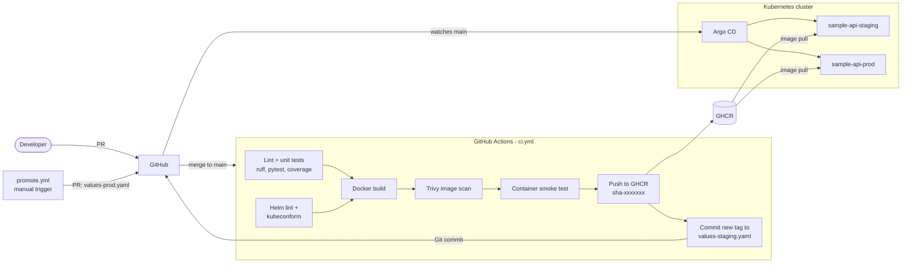

# gitops-cicd-pipeline-demo

End-to-end **CI/CD with GitOps** on Kubernetes. Every merge to `main` is tested, built into a container image, scanned for vulnerabilities, pushed to GitHub Container Registry, and deployed to **staging** automatically by **Argo CD**. Production is promoted through a reviewed pull request, and rolling back means reverting a commit.


---

## What this solves

Many teams deploy with `kubectl apply` from a laptop or give CI admin access to production clusters. Nobody can say exactly what's running where, and a rollback is a scramble. This repo shows the alternative:

- **Git is the single source of truth.** What's in `main` is what runs. Argo CD continuously reconciles the cluster to Git and reverts manual drift.
- **CI never touches the cluster.** The pipeline only builds images and commits a new tag to Git. Cluster credentials never leave the cluster.
- **Every change is traceable.** Each deployment is a Git commit: who, what, when, and why.
- **Production is gated.** Promotion is a pull request that someone has to approve.
- **Rollbacks take seconds.** Revert the commit and Argo CD rolls back.

## How it works



### 1. Pull request
`ci.yml` runs linting (ruff), unit tests with 85% minimum coverage (pytest), Helm lint, and Kubernetes schema validation (kubeconform) for both environments. It then builds the image, scans it with Trivy (fails on fixable HIGH or CRITICAL vulnerabilities), and smoke-tests the running container. Nothing is pushed from a PR.

### 2. Merge to `main`, deploying staging
The same checks run, then the image is pushed to GHCR tagged `sha-<commit>`. The `deploy-staging` job commits that tag into `helm/sample-api/values-staging.yaml`. Argo CD sees the commit and rolls it out to `sample-api-staging` with a zero-downtime rolling update.

### 3. Promoting to production
Run **Actions → promote to production → Run workflow**. It takes the tag currently in staging (or one you specify), checks that the image exists, and opens a pull request that changes `values-prod.yaml`. **Merging the PR is the production deployment.**

### 4. Rolling back
Revert the deploy commit or PR. Argo CD syncs the previous tag.

## Repository layout

```
.
├── app/                          # Python FastAPI service
│   ├── src/app/main.py           # health/readiness probes, Prometheus metrics, CRUD API
│   ├── tests/                    # pytest suite (100% coverage)
│   ├── Dockerfile                # multi-stage, non-root, slim runtime
│   └── pyproject.toml            # ruff + pytest config
├── helm/sample-api/              # Helm chart
│   ├── values.yaml               # shared defaults
│   ├── values-staging.yaml       # image tag bumped by CI
│   ├── values-prod.yaml          # image tag bumped by promotion PR
│   └── templates/                # Deployment, Service, Ingress, HPA, PDB, ServiceAccount
├── argocd/
│   ├── root-app.yaml             # app-of-apps: the only thing applied by hand
│   └── apps/                     # AppProject + staging and prod Applications
├── .github/workflows/
│   ├── ci.yml                    # test, validate, build, scan, push, deploy staging
│   └── promote.yml               # open a production promotion PR
├── scripts/kind-up.sh            # full local setup on kind
└── Makefile
```

## Run it locally

**Just the app:**

```bash
make install   # pip install dev dependencies
make test      # unit tests with coverage report
make run       # http://localhost:8080  (/docs for Swagger UI)
```

**The full GitOps flow on a local cluster** (needs Docker, [kind](https://kind.sigs.k8s.io/) and kubectl):

```bash
make kind-up
```

This creates a kind cluster, installs Argo CD, and applies `argocd/root-app.yaml`. Argo CD then creates the staging and prod applications from this repository. The script prints the Argo CD URL and admin password when it finishes.

## Setting it up on your fork

1. **Allow the workflows to write:** Settings → Actions → General → Workflow permissions → *Read and write permissions*, and tick *Allow GitHub Actions to create and approve pull requests* (needed by `promote.yml`).
2. **Make the image pullable:** after the first successful run on `main`, open the `gitops-cicd-pipeline-demo` package under your GitHub profile → Package settings → change visibility to **Public**. Alternatively, keep it private and add an `imagePullSecret` to the chart.
3. **Point Argo CD at your fork:** replace `sharanushettar644` in `argocd/` and `helm/sample-api/values.yaml`.
4. **Protect `main`** and require the `ci` checks to pass before merging.

## Security and reliability built in

| Area | What's done |
|---|---|
| Container | Multi-stage build, slim base, runs as non-root UID 10001, read-only root filesystem, all Linux capabilities dropped, seccomp `RuntimeDefault` |
| Supply chain | Trivy scan gates every image; immutable `sha-*` tags; OCI labels link each image to its commit; production refuses `latest` |
| CI permissions | Least-privilege `permissions:` per job; registry auth uses the short-lived `GITHUB_TOKEN`, so no stored secrets |
| Kubernetes | Readiness and liveness probes, resource requests and limits, PodDisruptionBudget, HPA in prod, topology spread across zones, `maxUnavailable: 0` rollouts |
| GitOps | Argo CD AppProject restricts repos and namespaces; automated sync with self-heal and prune; retry with backoff |
| Observability | Prometheus `/metrics` with request count and latency histograms (route-templated labels to keep cardinality low), plus scrape annotations |

## Next steps

- [ ] Argo CD Image Updater or Argo Rollouts canary releases with automated analysis
- [ ] Sign images with cosign and verify them with an admission policy (Kyverno)
- [ ] Sealed Secrets or External Secrets for application config
- [ ] Deploy onto the EKS cluster from [terraform-aws-eks-platform](https://github.com/sharanushettar644/terraform-aws-eks-platform)

## Author

**Sharanabasava Shettar**: DevOps Engineer | CKA, CKAD

I build CI/CD pipelines and Kubernetes platforms on AWS, Azure and GCP.
[LinkedIn](https://www.linkedin.com/in/sharan-shettar-0b699821a)

## License

[MIT](LICENSE)
